# Fondasi Manufaktur: Persona & Alur

> Menggambarkan **siapa** yang bekerja di alur manufaktur (produksi, PPIC, gudang bahan dan barang jadi, Quality) dan **bagaimana** pekerjaannya mengalir antar jabatan dan antar service. Dok induk: [[Manufacture - Kajian Fondasi Sistem]].
> **Status**: 🟡 **Konsep / Draft**. Ikut status dok induk. Alur di sini adalah **rancangan target** hasil kajian 2026-10-13 (SOP posisi, matriks KPI, kuesioner pemakai, spreadsheet PPIC, Batch Record kertas), bukan gambaran perilaku kode hari ini. Yang sudah ada di kode dan prod ditandai eksplisit di bagian Arsitektur. Langkah bertanda **TBD n** masih menunggu keputusan nomor n di dok induk.

## Sumber dan cara membaca

- **Alur proses dan alur per jabatan** diturunkan dari [[REF - SOP Bharata 2026 per Posisi]], [[HRIS - Matriks KPI per Departemen]], kuesioner ke 32 pemakai (14 responden), spreadsheet operasional PPIC, dan Batch Record kertas. Rinciannya di Temuan 3 sampai 7 dok induk.
- **Arsitektur** diturunkan dari kode `origin/main` 2026-10-12 dan data prod baca-saja 2026-10-13 (Temuan 1 dan 2 dok induk).
- Dok ini **tidak memuat nama orang**. Persona memakai jabatan; siapa memegang jabatan apa ada di HRIS.
- Diagram ditulis sebagai Mermaid supaya bisa disunting di vault. Versi interaktif (peta Archify) disimpan di luar vault sebagai salinan bertanggal; bila keduanya berbeda, dok ini yang berlaku.

## Aktor (ringkas)

| Persona | Peran & Divisi | Akses / RBAC | Device | Muncul di |
|---|---|---|---|---|
| **SPV Brand** | Marketing, pemesan barang jadi per brand | modul marketing (TBD menu Production Order) | Web ERP | Alur A, Production Order |
| **PPIC** | rencana produksi, MRP, permintaan pengadaan, jadwal | modul manufacture | Web ERP | Alur A dan B |
| **SPV Manufacture** | penyetuju rencana, pengadaan, bahan pengganti, opname; belum punya SOP | modul manufacture | Web ERP | Alur A, B, opname |
| **Procurement** | Leader dan Staff Inventory: PO bahan, ETA, retur pemasok | modul procurement | Web ERP | Alur A |
| **Gudang** | Staf, Admin, Leader Warehouse: terima, karantina, serah ke WIP, opname mingguan | modul manufacture (WMS) | Web ERP | Alur A dan B |
| **QC Assistant** | uji bahan masuk per lot | modul quality | Web ERP | Alur A |
| **Admin Produksi** | permintaan bahan, menyalin Batch Record dari kertas | modul manufacture | Web ERP | Alur B |
| **Leader Produksi** | verifikasi Batch Record | modul manufacture | Web ERP | Alur B |
| **Operator Produksi** | mengisi form kertas di lantai produksi | tidak perlu input ERP (hasil kuesioner) | kertas | Alur B |
| **QC Production** | uji IPC per tahap, ajukan rilis, terbitkan COA | modul quality | Web ERP | Alur B |
| **PJT / Supervisor Quality** | keputusan rilis batch, nasib barang ditolak, CAPA | modul quality (TBD) | Web ERP (kini kertas) | Alur B |
| **Finance** | Supervisor FAT, Accounting, Cost Control: validasi opname, Accurate, HPP | modul finance | Web ERP, Accurate | opname, HPP |
| **Admin Return** | scan retur marketplace ke stok FG | modul manufacture | Web ERP | sudah berjalan di prod |

## Alur A: rencana sampai bahan lulus QC

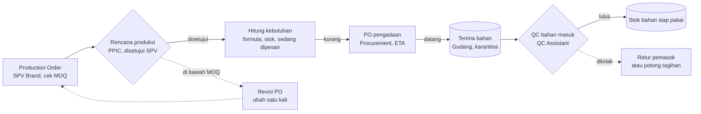

- Production Order di bawah MOQ dikembalikan untuk revisi satu kali (keputusan MOQ dan aturan ubah PO belum diambil).
- Bahan datang masuk **karantina** sampai QC memutuskan Lulus, Reject, atau Ditolak (TBD 4). Bahan Ditolak tidak pernah masuk stok.
- Kebutuhan bahan memperhitungkan bahan yang sedang dipesan, dibaca dari PO di Procurement.

## Alur B: produksi, rilis, dan pengiriman

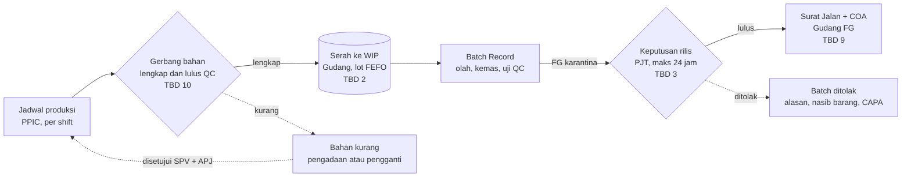

- Batch hanya boleh mulai bila semua bahan formula tersedia dan lulus QC. Penolakan batch yang ditemukan kajian berakar pada bahan pengganti, bukan hasil uji (Temuan 7).
- Admin Produksi menyalin Batch Record dari kertas; QC Production mengisi bagian uji di Batch Record yang sama.
- Barang jadi berstatus **FG karantina** sampai PJT memutuskan; FG tidak dianggap tersedia sebelum rilis.
- Batch ditolak wajib alasan, **nasib barang** (karantina, musnah, rework, lainnya), dan CAPA.

## Arsitektur service

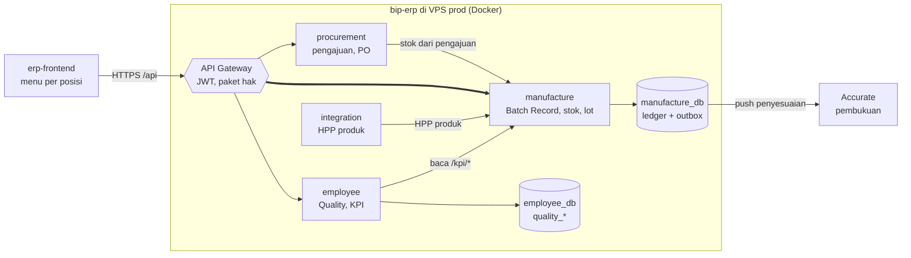

| Keadaan | Isi |
|---|---|
| ✅ Sudah ada di kode dan prod | rute Batch Record, cycle count, lot, K3/GMP, dan modul Quality; push gerakan stok ke Accurate menyala, tarik stok dari Accurate tiap 6 jam |
| ✅ Satu-satunya alur yang dipakai | scan retur marketplace (Gudang FG) |
| 🟡 Dirapikan di fondasi | satu Batch Record dan satu keputusan rilis; satu gerbang QC bahan masuk; satu jalur penyesuaian stok; PO bahan hanya di procurement (Temuan 2) |
| 🟡 Baru | menu per posisi mengikuti [[ADR - 0149 Sidebar Satu Daftar Urusan, Menu Digerbang Izin Posisi, Beranda Ruang Kerja Posisi]], gerbang ketersediaan bahan, COA keluar, dashboard jembatan dari spreadsheet PPIC |

## Alur per jabatan

Setiap diagram memisahkan pekerjaan jabatan itu sendiri dari pihak lain atau sistem yang ia ajak bertukar (garis putus-putus = kertas atau di luar ERP).

### Gudang (Staf, Admin, Leader Warehouse)

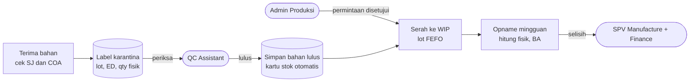

- Kartu stok kosmetik dan obat tradisional dicetak dari sistem untuk BPOM (TBD 5).

### Admin dan Leader Produksi

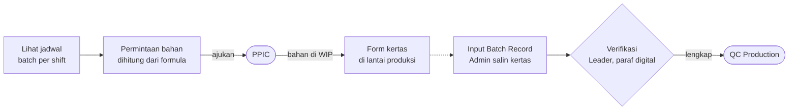

- Penyimpangan dihitung sistem dari selisih formula, penggantian bahan, dan rekonsiliasi, bukan diisi tangan.

### Operator Produksi

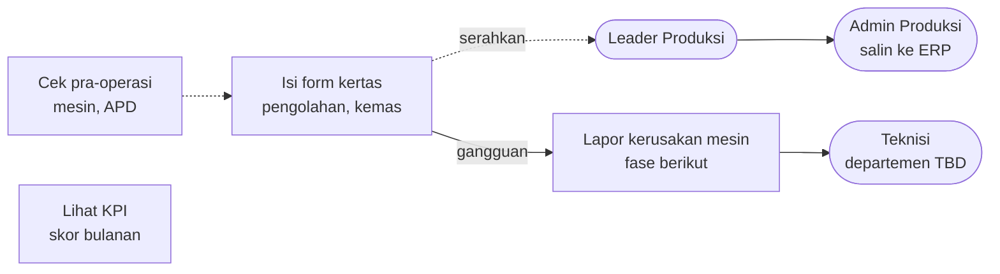

- Operator tidak menginput Batch Record; menu ERP-nya Beranda, KPI, dan lapor kerusakan mesin (fase berikut).

### QC Assistant

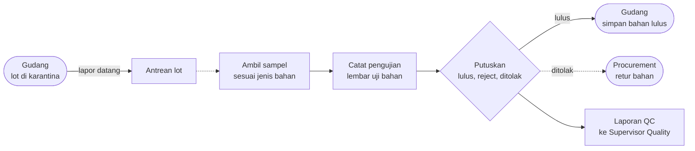

- Keputusan langsung mengubah status stok lot. Bahan ditolak diberi label merah, dipisah, dan dikonfirmasi Supervisor Quality.

### QC Production

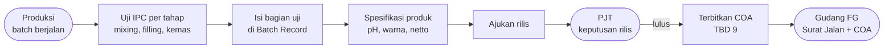

- Bagian spesifikasi produk (Temuan 6) dikerjakan M-03: master per produk ditulis QA/PJT, disalin ke Batch Record, hasil diisi QC (PR bip-erp#3084, belum merged + erp-frontend#2417). Ia menjadi isi utama COA keluar (M-21).

### PJT dan Supervisor Quality

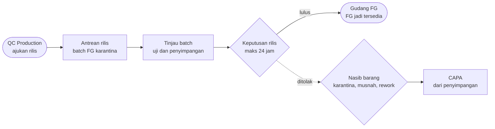

- Satu keputusan rilis per batch, di Batch Record (TBD 3). Penggantian bahan disetujui bersama SPV Manufacture (TBD 10).

### PPIC

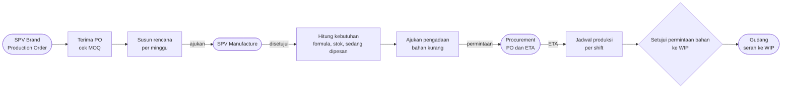

- Tab Rencana, MRP, safety stock, dan permintaan pengadaan di spreadsheet PPIC dipindah bertahap ke ERP (Temuan 4, TBD 7).

### SPV Manufacture

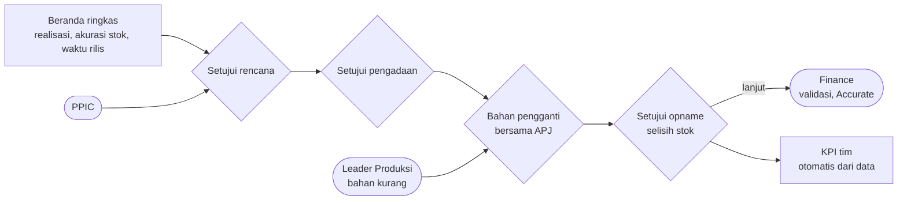

- Semua persetujuan masuk satu menu Persetujuan. Posisi ini belum punya SOP (TBD 8).

### Procurement (Leader, Staff Inventory)

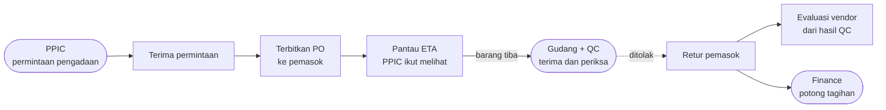

- PO bahan hanya dibuat di [[Microservices - Procurement Service]]; status dan ETA-nya dibaca PPIC sebagai bahan sedang dipesan.

### Finance (Supervisor FAT, Accounting, Cost Control)

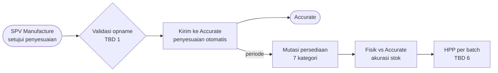

### SPV Brand (Marketing)

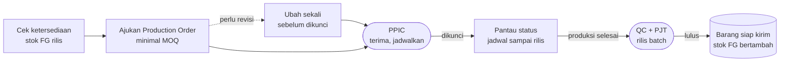

- Hanya produk brand sendiri yang terlihat. Saat ini MO Barang Jadi punya satu koleksi dengan tiga rute (Temuan 2 nomor 8).

### Admin Return (sudah berjalan)

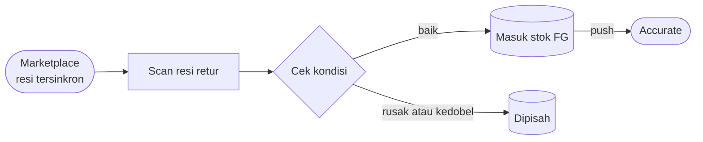

- Satu-satunya alur manufaktur yang aktif di prod (Temuan 1). Penataan fondasi tidak mengubahnya.

## Skenario Gagal

- Production Order di bawah MOQ → dikembalikan ke SPV Brand untuk revisi satu kali.
- Bahan ditolak QC → tidak masuk stok, diretur Procurement atau dipotong dari tagihan.
- Bahan formula kurang saat jadwal tiba → batch tidak boleh mulai; ajukan pengadaan atau bahan pengganti yang disetujui SPV Manufacture dan APJ, dan penggantian tercatat sebagai penyimpangan.
- Batch ditolak PJT → FG tetap karantina, wajib alasan, nasib barang, dan CAPA.
- Selisih opname → penyesuaian disetujui SPV Manufacture lalu divalidasi Finance sebelum dikirim ke Accurate.

## Dokumen Terkait

- [[Manufacture - Kajian Fondasi Sistem]] · [[Manufacture - Rancangan Menu per Posisi]] · [[Manufacture - Dashboard per Posisi]] · [[Manufacture - Dokumen Produksi Batch]] · [[Manufacture - Stock & Material Management]]
- [[Microservices - Manufacture Service]] · [[API - Manufacture Service]] · [[Microservices - Procurement Service]]
- [[QA - Quality Operasional (CAPA, Incoming, Batch Release)]] · [[Finance - FAT Persona]] · [[REF - SOP Bharata 2026 per Posisi]]
